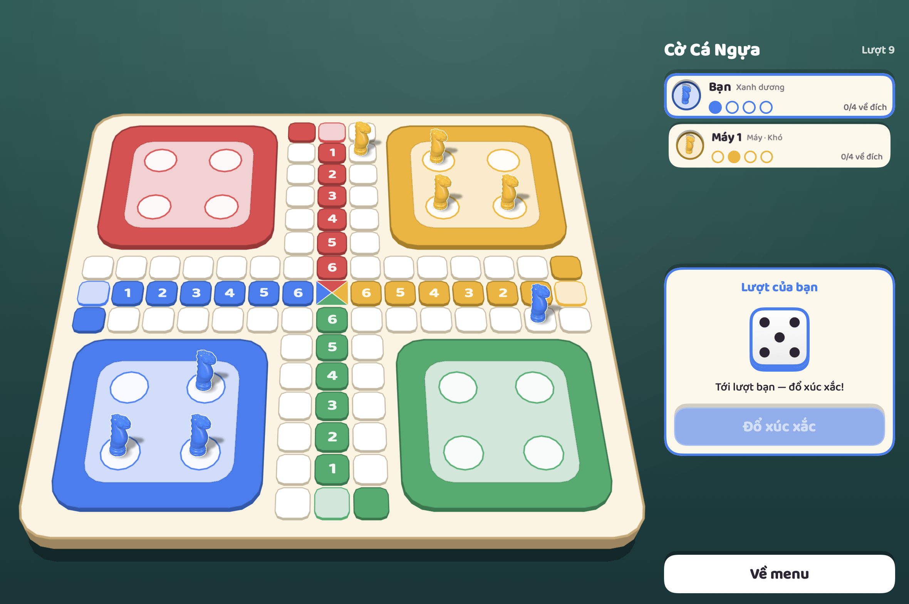

# Cờ Cá Ngựa

Trò chơi cờ cá ngựa tuổi thơ cho máy Mac: bàn cờ 2.5D, đấu với máy ở ba mức độ khó, giao diện tiếng Việt và tiếng Anh. Miễn phí, không quảng cáo, không thu thập dữ liệu.



## Tải về và cài đặt (macOS)

**Yêu cầu:** máy Mac chạy macOS 14 (Sonoma) trở lên, chip Apple Silicon hoặc Intel.

1. Vào trang [Releases](https://github.com/anhkhoi102/CoCaNgua/releases/latest) và tải file `CoCaNgua-0.1.0-macOS.zip`.
2. Bấm đúp file zip để giải nén, được `CoCaNgua.app`.
3. Kéo `CoCaNgua.app` vào thư mục **Applications** (Ứng dụng).
4. Mở app. Lần đầu macOS sẽ chặn vì app chưa được Apple chứng thực (xem bước dưới).

### Lần mở đầu tiên

App này chưa được ký bằng tài khoản Apple Developer, nên macOS sẽ báo không thể xác minh nhà phát triển. Làm một trong hai cách:

**Cách 1 – qua Cài đặt hệ thống**

1. Bấm đúp mở app, khi hiện cảnh báo thì bấm **Done** (Xong).
2. Mở **System Settings → Privacy & Security** (Cài đặt hệ thống → Quyền riêng tư & Bảo mật).
3. Kéo xuống cuối, ở dòng nói về "CoCaNgua" bấm **Open Anyway** (Vẫn mở), rồi xác nhận.

**Cách 2 – qua Terminal**

```bash
xattr -dr com.apple.quarantine /Applications/CoCaNgua.app
```

Sau đó mở app như bình thường. Chỉ cần làm một lần.

## Cách chơi

Mỗi người có 4 quân trong chuồng. Ai đưa được cả 4 quân lên các bậc 6, 5, 4, 3 của cột đích trước thì thắng.

### Điều khiển

- Bấm vào **xúc xắc** để đổ.
- Bấm vào **quân** đang sáng để chọn, rồi chọn nước đi nếu quân có nhiều lựa chọn.
- Khi chỉ có một nước đi thì quân tự đi. Riêng nước bay, nước đá quân và nước lên bậc thì game luôn để bạn tự chọn.

### Luật cơ bản

| Tình huống | Luật |
|---|---|
| Ra quân | Đổ được **6** thì đưa một quân từ chuồng xuống ô xuất phát |
| Đổ thêm | Đổ được 6 thì được đổ thêm lượt nữa |
| Di chuyển | Quân đi ngược chiều kim đồng hồ, đúng số bước của xúc xắc |
| Cản đường | Không được vượt qua bất kỳ quân nào đứng trên đường, kể cả quân mình |
| Đá quân | Đi **đúng số bước** tới ô có quân đối phương thì đá quân đó về chuồng |
| Bay | Đổ ra **1** thì được chọn: đi 1 bước, hoặc bay tới ô cửa chuồng gần nhất phía trước (nếu đường trống) |
| Tới cửa chuồng | Phải dừng đúng ô cửa chuồng của mình, không đi quá |
| Lên bậc | Từ cửa chuồng, đổ ra số nào thì lên bậc đó (đổ 6 lên bậc 6), miễn các bậc phía dưới trống |
| Leo bậc | Đã ở trong cột đích thì mỗi lần chỉ lên một bậc và phải đổ đúng số của bậc kế tiếp (đang ở 3 phải ra 4) |
| Không có nước đi | Mất lượt |

### Chế độ nhanh (2 xúc xắc)

Bật ở màn thiết lập ván chơi. Mỗi lượt đổ hai viên, bạn chọn:

- dùng **riêng từng viên** cho một hoặc hai quân, hoặc
- **cộng hai viên** cho một quân đi một mạch.

Ở chế độ này chỉ ra **đôi** mới được đổ thêm. Ra quân và lên bậc vẫn cần một viên ra đúng số, không tính tổng.

Luật đầy đủ: [Docs/RULES.md](Docs/RULES.md).

## Các chế độ

- **Chơi đơn:** bạn đấu với 1–3 máy, chọn màu quân và độ khó (dễ, vừa, khó). Độ khó chỉ thay đổi cách máy chọn nước đi; xúc xắc ngẫu nhiên như nhau cho mọi người.
- **Chơi mạng:** bản tải về này **chưa chơi mạng được**. Tính năng tạo phòng theo mã dùng Game Center, cần bản được ký bằng tài khoản Apple Developer, và chưa được thử với tài khoản thật.
- **iPhone:** mã nguồn đã build và chạy được trên trình giả lập iPhone, nhưng chưa có bản cài cho máy thật.

Trong **Cài đặt** có thể đổi ngôn ngữ (Tiếng Việt / English), âm lượng, mẫu quân cờ và tốc độ hoạt ảnh.

## Tự build từ mã nguồn

Cần Xcode (đã thử với Xcode 27.2).

```bash
git clone https://github.com/anhkhoi102/CoCaNgua.git
```

```bash
cd CoCaNgua && Scripts/build.sh
```

App nằm ở `build/CoCaNgua.app`. Chạy bộ kiểm thử bằng `Scripts/test.sh`, đóng gói bản phát hành bằng `Scripts/package-macos.sh`. Cấu trúc mã: [Docs/ARCHITECTURE.md](Docs/ARCHITECTURE.md).

## Tài nguyên bên thứ ba

Âm thanh, nhạc, mẫu quân 3D và phông chữ đều dùng giấy phép CC0 hoặc SIL OFL. Danh sách và nguồn: [THIRD_PARTY_ASSETS.md](THIRD_PARTY_ASSETS.md).
